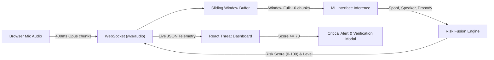

# VoiceGuard: Real-Time Voice Anti-Spoofing & Deepfake Detection

[](https://www.sih.gov.in/)
[](https://fastapi.tiangolo.com)
[](https://react.dev/)
[](https://vitejs.dev/)
[](https://websockets.readthedocs.io/)
[](LICENSE)

---

## SIH 2026
- **Problem Statement ID**: SIH-26104
- **Problem Statement Title**: Real-Time Voice Anti-Spoofing & Impersonation Detection in Telecommunications
- **Domain**: Cyber Security / Artificial Intelligence / Telecom Fraud Prevention

---

## Problem Statement
The exponential rise of generative AI, text-to-speech (TTS) synthesis, and real-time voice conversion (VC) models has made high-fidelity voice cloning accessible to malicious actors. Threat actors increasingly exploit synthetic voices and deepfake audio to execute:

1. **CEO Fraud & Financial Scams**: Social engineering attacks tricking employees and bank customers into unauthorized fund transfers.
2. **Biometric Bypass**: Spoofing automated Interactive Voice Response (IVR) systems and phone-based biometric voice verification.
3. **Impersonation & Blackmail**: Targeting citizens through synthetic emergency calls, distress scams, and authority impersonation.

### Why Traditional Systems Fail
- Traditional audio forensics rely on **post-call forensic analysis** or **batch-file processing**, which cannot protect users during an active phone conversation.
- Single-signal detectors (such as simple pitch or volume checks) suffer from high false-positive rates due to microphone noise, network jitter, and diverse acoustic environments.
- High latency prevents instant, actionable interventions before fraudulent actions occur.

---

## Our Solution
**VoiceGuard** is an end-to-end, sub-second latency, real-time voice anti-spoofing and caller identity verification platform. It sits unobtrusively in the audio path to safeguard callers and contact centers against deepfake attacks and voice cloning fraud.

VoiceGuard continuously ingests live microphone audio via binary WebSocket streams, segments speech through an intelligent **Sliding-Window Temporal Buffer**, and evaluates multiple acoustic dimensions using a decoupled **Risk Fusion Engine**. The system outputs a dynamic, unified risk score (0–100) and risk tier (`SAFE`, `SUSPICIOUS`, `CRITICAL`), delivering live visual telemetry, risk trends, and step-up biometric verification directly within the active call interface.

---

## Key Features

- **⚡ Real-Time Sliding-Window Audio Ingestion**:
  Captures ~400ms WebM/Opus audio chunks directly from the browser MediaRecorder and slides through rolling analysis windows (4.0s window, stepping every 800ms) for uninterrupted, low-latency evaluation.

- **🛡️ Multi-Signal Risk Fusion Engine**:
  Synthesizes multiple biometric and forensic signals into a unified threat metric:
  - **Acoustic Spoof Probability (55% weight)**: Neural detection of generative synthesis artifacts and spectral phase incoherence.
  - **Speaker Similarity Match (25% weight)**: Biometric distance against the genuine enrolled voiceprint.
  - **Prosodic Anomaly Score (10% weight)**: Temporal jitter, pitch flatness, and unnatural rhythm cadence analysis.
  - **Phonetic & Contextual Risk (10% weight)**: Transition boundary anomalies and metadata indicators.

- **📊 Live Threat Telemetry & Dynamic Risk Gauge**:
  Interactive, color-coded visual indicator displaying instantaneous risk status (`SAFE`: 0–39 | `SUSPICIOUS`: 40–69 | `CRITICAL`: 70–100) with sub-second needle transitions and visual warning cues.

- **📈 Real-Time Temporal Risk Graph**:
  Interactive historical timeline powered by Recharts tracking risk fluctuations across call duration, allowing operators to spot transient spoofing attempts.

- **🔐 Interactive Step-Up Caller Verification**:
  In-call secondary challenge modal enabling one-click biometric verification (e.g., dynamic passphrases or OTP validation) without hanging up the call.

- **🧩 Decoupled, Production-Ready ML Interface Contract**:
  Clean abstraction boundary (`ml_interface.py` & `BaseRiskFusionEngine`) allowing ML teams to plug in production PyTorch/ONNX models (e.g., RawNet2, AASIST, Whisper-based detectors) without altering network or frontend infrastructure.

- **💾 Dual-Mode Session Telemetry**:
  Seamless support for in-memory session tracking and optional MongoDB Atlas persistent audit logging for compliance and forensic reviews.

---

## Tech Stack

| Layer | Technologies |
|---|---|
| **Frontend** | React 19, Vite 8, Recharts, Vanilla CSS3 (Custom Glassmorphism Design System), Web Audio API / MediaRecorder |
| **Backend** | Python 3.11+, FastAPI (Asynchronous ASGI), Uvicorn, WebSockets, Pydantic v2 & Pydantic-Settings |
| **Database** | MongoDB Atlas (Motor Async Driver) with Fallback In-Memory Session Storage |
| **ML / AI** | PyTorch / ONNX Runtime interface contract, Sliding-Window Acoustic Feature Extractor, Heuristic & Probabilistic Risk Fusion |
| **Testing & Quality** | Pytest, AnyIO, Starlette TestClient, Oxlint |
| **Environment / Ops** | Python `venv`, dotenv (`.env`), RESTful & WebSocket Endpoints |

---

## System Architecture

```text
                                    ┌─────────────────────────────────────────────────────────────┐
                                    │                     USER BROWSER / CLIENT                   │
                                    │                                                             │
                                    │  ┌───────────────────────┐       ┌───────────────────────┐  │
                                    │  │  MediaRecorder API    │       │   React 19 Dashboard  │  │
                                    │  │ (WebM/Opus ~400ms)    │       │ (Gauge, Graph, Modal) │  │
                                    │  └───────────┬───────────┘       └───────────▲───────────┘  │
                                    └──────────────┼───────────────────────────────┼──────────────┘
                                                   │ Binary Audio                  │ Telemetry JSON
                                                   │ ws://.../ws/audio             │ (Risk Score, Level)
                                                   ▼                               │
┌──────────────────────────────────────────────────────────────────────────────────┴──────────────┐
│                                     FASTAPI ASYNC BACKEND                                       │
│                                                                                                 │
│  ┌────────────────────────┐         ┌────────────────────────┐         ┌─────────────────────┐  │
│  │   WebSocket Handler    │ ──────> │  Sliding Window Buffer │ ──────> │    ML Interface     │  │
│  │     (ws_audio.py)      │         │ (~4s Window, 0.8s Step)│         │  (ml_interface.py)  │  │
│  └────────────────────────┘         └────────────────────────┘         └──────────┬──────────┘  │
│                                                                                   │             │
│                                                                                   ▼             │
│  ┌────────────────────────┐         ┌────────────────────────┐         ┌─────────────────────┐  │
│  │    MongoDB Atlas       │ <────── │  Session Store & REST  │ <────── │ Risk Fusion Engine  │  │
│  │  (Audit & Compliance)  │         │      (rest_api.py)     │         │   (risk_engine.py)  │  │
│  └────────────────────────┘         └────────────────────────┘         └─────────────────────┘  │
└─────────────────────────────────────────────────────────────────────────────────────────────────┘
```

### End-to-End Component Flow


---

## Workflow

1. **Call Initiation & Handshake**:
   - The user receives an incoming call notification on the dashboard and clicks **Accept**.
   - The frontend requests a new session from `POST /api/sessions` and establishes a bidirectional WebSocket connection to `ws://localhost:8000/ws/audio?session_id={id}`.
2. **Audio Streaming & Rolling Buffer**:
   - The browser `MediaRecorder` captures raw microphone audio in ~400ms WebM/Opus binary frames.
   - Binary chunks are streamed continuously over the WebSocket to the backend.
   - The backend `SlidingWindowBuffer` accumulates audio in a 10-chunk rolling deque (~4.0 seconds of audio).
3. **Warmup & Continuous Inference**:
   - During the first 10 chunks, the server returns real-time `"warming_up"` progress updates.
   - Once the window fills, inference triggers immediately and subsequently updates every 2 new chunks (~800ms sliding step).
4. **ML Feature Extraction & Risk Fusion**:
   - The model evaluates acoustic anomalies (`spoof_probability`), compares voiceprints (`speaker_similarity`), analyzes rhythm/pitch (`prosodic_anomaly`), and checks contextual signals.
   - The `HeuristicWeightedFusionEngine` fuses normalized indicators:
     ```text
     Raw Score = (Spoof_Prob * 0.55) + ((1 - Speaker_Sim) * 0.25) + (Prosody_Anomaly * 0.10) + (Context_Risk * 0.05)
     ```
   - The score is scaled (0–100) and categorized into **SAFE** (0–39), **SUSPICIOUS** (40–69), or **CRITICAL** (70–100).
5. **Real-Time Client Updates**:
   - The React dashboard receives the telemetry JSON payload and dynamically updates the **Risk Gauge**, **Confidence Meters**, and **Recharts Timeline**.
6. **Active Defense & Caller Verification**:
   - If the risk transitions into `SUSPICIOUS` or `CRITICAL`, audible and visual alert banners trigger.
   - The user or operator can launch the **Biometric Verification Modal** to challenge the caller with a dynamic phrase or step-up authentication.
7. **Call Termination & Audit Logging**:
   - Hanging up triggers `end_session`, flushing buffers and saving session telemetry for post-call audit and analytics.

---

## Installation

### Prerequisites
- **Python**: `3.11` or higher
- **Node.js**: `18.0.0` or higher (Node 20+ recommended)
- **npm**: `9.0.0` or higher
- **Git**

---

### Step 1: Clone the Repository
```bash
git clone https://github.com/Adarsh-2413/SIH-26104.git
cd SIH-26104
```

---

### Step 2: Backend Setup
```bash
# Navigate to backend directory
cd backend

# Create a virtual environment
python -m venv venv

# Activate virtual environment
# Windows (PowerShell):
.\venv\Scripts\Activate.ps1
# Windows (CMD):
.\venv\Scripts\activate.bat
# Linux / macOS:
source venv/bin/activate

# Install dependencies
pip install -r requirements.txt

# Create your .env file
copy .env.example .env   # On Windows
# cp .env.example .env   # On Linux/macOS
```

#### Optional `.env` Configuration
Open `backend/.env` to customize settings:
```ini
APP_ENV=development
APP_HOST=0.0.0.0
APP_PORT=8000
CORS_ORIGINS=http://localhost:5173

# Audio Sliding Window (400ms chunks)
AUDIO_WINDOW_SIZE=10
AUDIO_STEP_SIZE=2

# Risk Engine Tuning
RISK_WEIGHT_SPOOF=0.55
RISK_WEIGHT_SPEAKER=0.25
RISK_WEIGHT_PROSODIC=0.10
RISK_WEIGHT_PHONETIC=0.05
RISK_WEIGHT_CONTEXT=0.05

# Optional MongoDB Connection (leave empty for in-memory mode)
MONGODB_URI=
MONGODB_DB_NAME=sih26104
```

---

### Step 3: Frontend Setup
```bash
# Open a new terminal and navigate to frontend directory
cd frontend

# Install Node dependencies
npm install
```

---

## Usage

### 1. Run the Backend API Server
```bash
cd backend
# Make sure virtual environment is active
uvicorn app.main:app --reload --port 8000
```
- Backend API Docs: [http://localhost:8000/docs](http://localhost:8000/docs)
- Health Check: [http://localhost:8000/health](http://localhost:8000/health)
- WebSocket Endpoint: `ws://localhost:8000/ws/audio`

### 2. Run the Frontend Dashboard
```bash
cd frontend
npm run dev
```
- Open your browser at [http://localhost:5173](http://localhost:5173).

### 3. Run Automated Backend Tests
```bash
cd backend
pytest -v
```
All unit tests for the sliding window buffer, risk fusion mathematics, and WebSocket endpoints will execute and validate the pipeline.

---

## Team

| Name | Role / Domain | Contribution Area |
|---|---|---|
| **Member 1** | Team Lead / Backend Engineer | FastAPI Architecture, WebSocket Pipeline, Sliding Window Engine |
| **Member 2** | ML / Deep Learning Engineer | Voice Anti-Spoofing Models, Feature Extraction & Biometrics |
| **Member 3** | Frontend / UI-UX Engineer | React Dashboard, Recharts Visualizations, Audio Capture |
| **Member 4** | Cyber Security & Cloud Engineer | Threat Fusion Heuristics, Database Integration & Deployment |
| **Member 5** | Full Stack / QA Engineer | Test Suites, API Integration & Telemetry Analytics |
| **Member 6** | Research & Audio Processing | Dataset Preparation, ASVspoof Benchmarking & Prosody Analysis |

---

## Future Scope

1. **On-Device Edge Inference (WebAssembly / ONNX Runtime Web)**:
   Deploy lightweight quantized acoustic models directly inside mobile/web clients to analyze audio locally before transmitting, preserving privacy and saving network bandwidth.
2. **VoIP & SIP Trunk Integration**:
   Build native connectors for Asterisk PBX, FreeSWITCH, and Twilio Voice SDKs to provide inline enterprise-grade call protection for bank call centers.
3. **Foundation Audio Models (Wav2Vec 2.0 / HuBERT)**:
   Incorporate self-supervised speech foundation models fine-tuned on multi-lingual deepfake datasets to boost generalization against unseen synthesis architectures.
4. **Synthetic Speech Watermark Verification**:
   Integrate automated detection for AI watermarks (e.g., SynthID for Audio) emitted by commercial generative AI providers.
5. **Multi-Dialect & Background Noise Resilience**:
   Enhance prosodic modeling with noise-robust neural front-ends (e.g., PercepNet / DeepFilterNet) to ensure high precision in loud Indian street and ambient noise conditions.

---

## Screenshots

### 1. Incoming Call Screen
*Simulates an incoming cellular / VoIP call with caller metadata, live threat monitoring status, and accept/decline actions.*

```text
┌──────────────────────────────────────────────────────┐
│                    🛡️ VoiceGuard                     │
│               INCOMING CALL DETECTED                 │
│                                                      │
│                        👤                            │
│                  Unknown Caller                      │
│                  +91 98XXX XXXXX                     │
│                  New Delhi, India                    │
│                                                      │
│        [ 🟢 Accept Call ]      [ 🔴 Decline ]        │
└──────────────────────────────────────────────────────┘
```

---

### 2. Active Call & Live Telemetry Dashboard
*Continuous real-time speech monitoring featuring the sub-second Risk Gauge, individual threat factors, and dynamic status badge.*

```text
┌──────────────────────────────────────────────────────┐
│ 📞 ACTIVE CALL: 00:01:24            [ 🔴 END CALL ]  │
│ Caller: Unknown Caller (+91 98XXX XXXXX)             │
│                                                      │
│              ⚡ THREAT LEVEL: SAFE (18/100)           │
│                 [======>................]            │
│                                                      │
│  [Spoof Probability: 0.12]   [Speaker Match: 0.89]   │
│  [Prosodic Anomaly:  0.08]   [Context Risk:  0.05]   │
│                                                      │
│         [ 🔐 Initiate Biometric Verification ]       │
└──────────────────────────────────────────────────────┘
```

---

### 3. Real-Time Temporal Risk Timeline
*Live Recharts dynamic graph tracking risk score fluctuations across the entire duration of the call.*

```text
Score
100 ┤
 80 ┤                            .-.  (Spoof Attempt Spike)
 60 ┤               .-----------'   '--.
 40 ┤- - - - - - - / - - - - - - - - - -\- - Threshold: Suspicious
 20 ┤─────────────'                      '─────────────
  0 └────────────────────────────────────────────────── Time
      00:10       00:30        00:50        01:10
```

---

### 4. Interactive Step-Up Verification Modal
*In-call challenge modal enabling dynamic challenge-response passphrases and verification before sensitive transactions.*

```text
┌──────────────────────────────────────────────────────┐
│             🔐 BIOMETRIC VERIFICATION                │
│                                                      │
│  Ask caller to speak the dynamic verification phrase:│
│                                                      │
│       "Delta Seven Tangerine Nine Two"               │
│                                                      │
│  [ Listening for Phrase Response... ]                │
│                                                      │
│      [ ✅ Verify Voiceprint ]   [ ❌ Flag & End ]    │
└──────────────────────────────────────────────────────┘
```

---

<p align="center">
  <b>Built with ❤️ for Smart India Hackathon (SIH 2026)</b><br>
  <i>Securing voice communications against deepfakes and generative AI impersonation.</i>
</p>
